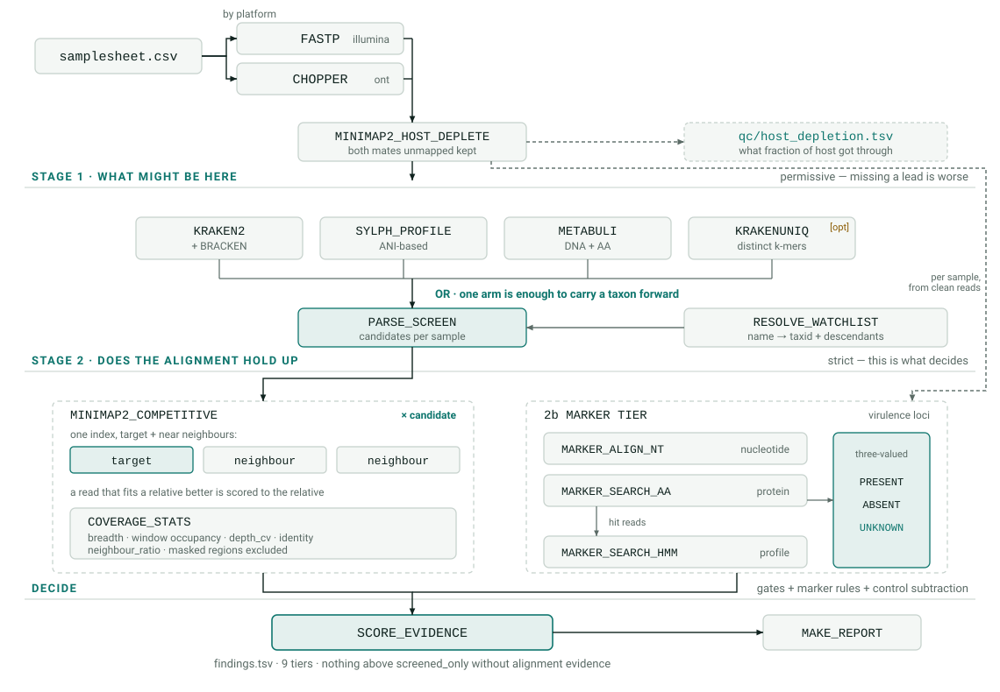

<h1>
  <picture>
    <source media="(prefers-color-scheme: dark)" srcset="assets/logo/bioThreatFinder-logo-dark.svg">
    
  </picture>
</h1>

Metagenomic screening and in-silico confirmation of high-consequence pathogens,
across human, animal and plant health.

> **This tool produces analytical evidence, not diagnoses.** Sequence detection
> does not establish viable organism, active infection, or exposure. Every
> finding requires orthogonal laboratory confirmation and interpretation by a
> qualified laboratorian before any clinical or public-health action.

---

## Documentation

| Document | What it is for |
|---|---|
| [`docs/decisions.md`](docs/decisions.md) | **Why each tool was chosen**, the evidence behind it, and what would reverse it. Evidence is tagged independent / tool-paper / read-from-source / measured-here / reasoned, so judgement is distinguishable from measurement. Includes two decisions that were reversed. |
| [`docs/samplesheet.md`](docs/samplesheet.md) | The input format, column by column — and what `role=control` actually does, including the run-global scope of control subtraction and how to read the audit table before trusting a negative. |
| [`docs/verification.md`](docs/verification.md) | What has actually been checked, how to re-run it, and an explicit list of what has **not** been checked. |
| [`docs/benchmarking.md`](docs/benchmarking.md) | Benchmark design, the tool bake-off, and what simulation cannot tell you. |
| [`docs/validation.md`](docs/validation.md) | The route to a defensible result: normative standards, reference materials, EQA, regulatory position. |
| [`docs/roadmap.md`](docs/roadmap.md) | What is not built, ranked by published effect size. |
| [`docs/STATUS.md`](docs/STATUS.md) | Session handoff: what is running, environment traps, unresolved questions. |

```bash
python3 tests/test_pipeline.py     # 108 checks with samtools on PATH; 89 passed /
                                   # 2 skipped without it, ~30 s, no databases
```

## Workflow

<picture>
  <source media="(prefers-color-scheme: dark)" srcset="assets/workflow/bioThreatFinder-workflow-dark.svg">
  
</picture>

Boxes are named as they appear in the Nextflow trace. `[opt]` is off by default and
`x candidate` marks the fan-out: the competitive alignment runs once per (sample x
watchlist candidate), while the marker tier runs once per sample off the host-depleted
reads (`main.nf:498`).
Regenerate with `python3 scripts/make_workflow_svg.py`.

The two things worth taking from it. Stage 1 is an **OR** — a single arm nominating a
taxon carries it forward, because missing a lead costs more than carrying a false one into
stage 2. And stage 2 maps against an index holding the **target together with its near
neighbours**, so a read that fits a harmless relative better is scored to the relative
rather than to the agent; that split is what `neighbour_ratio` measures. Nothing above
`screened_only` is reported on stage-1 evidence alone.

<details>
<summary>Same diagram as text, for terminals and plain-text viewers</summary>

```text
  samplesheet.csv ──┬── illumina (paired) ──► FASTP ──┐
                    └── ont (single)      ──► CHOPPER ─┤
                                                       ▼
                                      MINIMAP2_HOST_DEPLETE          pack.yaml
                                      host reads removed                 │
                                   ┌───────────┴───────────┐             ▼
                                   │                       │     RESOLVE_WATCHLIST
                      qc/host_depletion.tsv          SEQKIT_STATS   name ──► taxid
                      how much host got through           │         + descendants
                                                          │               │
  ═════════ STAGE 1 ─ what MIGHT be here (permissive, any-arm OR) ════════│════════
                                                          │               │
                    ┌──────────────┬──────────────┬───────┴──────┐        │
                    ▼              ▼              ▼              ▼        │
                 KRAKEN2        SYLPH_PROFILE  METABULI      KRAKENUNIQ   │
                 + BRACKEN      ANI-based      DNA + AA      distinct     │
                 (illumina)                    [opt]         k-mers [opt] │
                    └──────────────┴──────────────┴──────────────┘        │
                                          │                              │
                                          ▼                              │
                                    PARSE_SCREEN ◄───────────────────────┘
                                    candidates.tsv per sample
                                          │
  ═════════ STAGE 2 ─ does the ALIGNMENT hold up? (strict, this decides) ══════════
                                          │
                 ▼
    MINIMAP2_COMPETITIVE [per candidate]            2b. MARKER TIER
                                                    ▲ per sample,
                                                    │ not per candidate
       clean reads (main.nf:506) ───────────────────┘
    target + near neighbours in ONE index           MARKER_ALIGN_NT  (nucleotide)
                 │                                  MARKER_SEARCH_AA (protein)
                 │                                          │ hit reads
                 │                                          ▼
                 │                                  MARKER_SEARCH_HMM (profile)
                 ▼                                          │
          COVERAGE_STATS                                    ▼
          breadth · window occupancy               MARKER_EVIDENCE
          depth_cv · identity                      PRESENT / ABSENT / UNKNOWN
          neighbour_ratio                          per virulence locus
          masked regions excluded                  (UNKNOWN when depth is too
                                                    low to call absence)
                 │                                            │
                 └────────────────────┬───────────────────────┘
                                      ▼
                               SCORE_EVIDENCE
                               gates + marker rules + control subtraction
                                      │
                                      ▼
                                 findings.tsv
                     confirmed_in_silico · supported · screened_only
                     attributed_to_neighbour · suppressed_control
                     control_background · marker_veto · vaccine_strain
                     no_reference
                                      │
                                      ▼
                                 MAKE_REPORT
                          report.html + summary.tsv
```

</details>

## Why two stages

Stage-1 metagenomic classifiers (Kraken2, sylph, Centrifuge) are built for
*community profiling*. They answer "what is the composition of this sample",
and they are good at it. They are not built to answer "is organism X present",
which is a fundamentally different question with a much harsher false-positive
cost.

A handful of k-mers shared with a common environmental relative is enough to
place a high-consequence taxon in a Kraken2 report. Run a classifier over a
soil or sputum metagenome and you will see plenty of alarming names in the
output. Essentially all of them are noise.

So the pipeline splits the question:

| Stage | Question | Tooling | Posture |
|---|---|---|---|
| 1 | What *might* be here? | Kraken2/Bracken + sylph by default; Metabuli and KrakenUniq opt-in | Deliberately permissive — missing a lead is worse than carrying a false one forward |
| 2 | Does the alignment evidence hold up? | Competitive minimap2 + coverage geometry | Strict — this is what decides |

Stage 2 is where the tool earns its keep. For every watchlist candidate it maps
reads against a bundle containing the **target plus its near neighbours**, then
asks four things that k-mer counting cannot:

- **Breadth** — what fraction of the reference is covered at all? A real
  organism at low abundance spreads thin across the whole genome. An artifact
  stacks on one conserved gene.
- **Window occupancy** — breadth's robust sibling. At very low depth, breadth is
  small either way, but 40 reads across 40 windows is an organism and 40 reads
  in 2 windows is a repeat.
- **Competitive attribution** — do these reads actually prefer the target, or do
  they prefer its harmless relative? `neighbour_ratio` below ~1 means the answer
  is the relative.
- **Control subtraction** — is this above what the negative control shows?

## Evidence tiers

Every finding is assigned a tier and carries a `reasons` string explaining which
gate decided it. Nothing is a bare verdict.

| Tier | Meaning |
|---|---|
| `confirmed_in_silico` | Met every threshold. **Still requires wet-lab confirmation.** |
| `supported` | Real alignment evidence, below the confirmation bar |
| `no_reference` | On the watchlist, raised by the screen, but no reference genome available — **a database gap, not a negative result** |
| `suppressed_control` | Comparable level in a negative control; contamination until proven otherwise |
| `attributed_to_neighbour` | Reads align better to a relative |
| `control_background` | What the control itself contains (QC, not a finding) |
| `screened_only` | Stage-1 lead that failed stage-2 — the expected fate of classifier noise |

## Stage 1: classifier arms

One classifier is not good enough for an "is organism X present" question, and the
arms fail in different directions. **Two run by default; Metabuli and KrakenUniq are
opt-in.**

| Arm | Default | What it contributes |
|---|---|---|
| **Kraken2 + Bracken** *(primary)* | on | Distinct **minimizer** count and duplicity via `--report-minimizer-data`, plus Bracken abundance |
| sylph | on | ANI/containment; very low FP for bacteria and fungi |
| Metabuli | **off** (`--skip_metabuli` defaults true) | Joint DNA + amino-acid k-mers, for divergent and novel agents. Measured, it has changed no decision on any scenario yet run — see below |
| KrakenUniq | **off** (`--skip_krakenuniq` defaults true) | Distinct **k-mer** cardinality. A second opinion, not a dependency — see below |

Both opt-in flags take an explicit value: `--skip_metabuli false` enables the arm, and
omitting the flag leaves it off. On the Nextflow CLI a bare `--flag false` arrives as the
string `"false"`, which is truthy in Groovy, so these spellings were silent no-ops until
`lib/BtfBool.groovy` began coercing them — see D2 and D15.

**Kraken2 is primary; KrakenUniq is opt-in.** An earlier version of this design made
KrakenUniq primary on the grounds that "Kraken2 only counts reads." That was wrong.
Kraken2's `--report-minimizer-data` columns are *literally KrakenUniq's HyperLogLog
implementation* — same author, same `hyperloglogplus.h`, same default precision
p=12 — counting distinct **minimizers** instead of distinct **k-mers**. The only
published comparison (Oskolkov 2026, *Front Microbiol*, doi:10.3389/fmicb.2026.1603339)
finds **comparable F1** once the threshold is shifted by the 2–3× that minimizer
subsampling implies: ~1,000 unique k-mers for KrakenUniq vs ~2,000–3,000 distinct
minimizers for Kraken2. KrakenUniq has had no commit since December 2023.

So the distinct-k-mer signal is kept and KrakenUniq's index is not. If you want it
as a second opinion, **download a prebuilt index rather than building one** — a
build costs ~1400 GiB transient and needs Jellyfish 1.x.

Three caveats on Kraken2's columns, verified from source rather than inferred:
columns 4–5 are **clade-aggregated**, so threshold at species rows and not genus
rows; minimizers are keyed by the minimizer's database LCA, not the read's final
call; and upstream issue #445 (column 5 exceeding `kraken2-inspect`'s count) is
still open, so treat column 5 as a monotone evidence score to calibrate empirically,
not as a literal breadth measurement.

Demonstrated on fixtures — comparable read counts, opposite k-mer evidence. The
current flag threshold is `min_distinct_kmers = 2000`, taken from Oskolkov's measured
Kraken2 optimum rather than reasoned; it still needs recalibrating on your own panel
and depth, which is what the benchmark is for:

| Taxon | Reads | Distinct k-mers | Dup | Arms | Outcome |
|---|---|---|---|---|---|
| *Y. pestis* | 800 | 45,000 | 1.2 | 4 | clean |
| *B. anthracis* | 600 | **78** | **41.2** | 2 | flagged at stage 1 |
| Zaire ebolavirus | 120 | 3,100 | 1.1 | 2 | clean |

⚠️ **That last row used to read "and Metabuli found 3× what the nucleotide arm did",
glossed as "the divergence arm earning its place". It is removed because the project
then measured it and found the opposite.** These are FIXTURE numbers, written to
illustrate the k-mer columns; the divergence claim attached to them was never measured. On
the real divergent-agent proxy (`divergent_bundibugyo_filovirus`, Bundibugyo virus at
200 RPM) Kraken2 and Metabuli each assign **all 3,992 spiked reads to the same taxon, read
for read**, and across every scenario run so far the amino-acid arm has changed **zero**
findings. See D15 and `docs/benchmarking.md`. The arm is kept because its untested case —
an agent absent from the index — cannot be simulated from a database, not because this
table ever supported it.

**Combining rule: any-classifier OR.** Any arm raises a candidate; stage 2
discriminates. Requiring consensus would discard the sensitivity that running four
arms buys. What consensus *does* do is get recorded — `n_classifiers` and the arm
list travel into scoring and into the report, because a taxon seen by three
independent methods is much stronger evidence than one seen by a single k-mer
counter. K-mer quality is likewise **flagged, never enforced** at stage 1: a flag
that reaches scoring is more useful than a candidate that silently vanished.

**Two guards worth knowing about.**

*Taxonomy namespace.* Metabuli publishes GTDB-based indexes as well as
NCBI-based ones, and **GTDB taxids are not NCBI taxids**. Point the pipeline at a
GTDB index and every watchlist lookup misses — producing not an error but an empty
result, indistinguishable from a clean negative across the entire screen. A silent
false negative on every watchlist organism is worse than a crash, so the pipeline
reads `BTF_BUILD_MANIFEST.txt` and **refuses to run** on a non-NCBI index rather
than warning. `parse_screen.py` also detects the same mismatch from the data side,
in case an index arrives without a manifest.

*HLL precision is a query parameter, not a build parameter.* The sketches are
built while reading each sample, so `--hll-precision` belongs to the classifier.
The build script records the intended value beside the index and the module reads
it back, so query and build cannot drift. Default 12 gives ~1.6% relative error;
stage 1 uses cardinality as a threshold gate where real separation is ~10×, so
that changes no call, while p=18 would cost 64× the sketch memory across tens of
thousands of taxa.

One correctness detail worth knowing: **HyperLogLog cardinalities are not
additive.** Summing the `kmers` column across descendant nodes double-counts shared
k-mers and inflates the number, sometimes badly. So distinct-k-mer evidence uses
the watchlist node's own clade estimate, falling back to the *maximum* over
descendants — never the sum. Read counts, being plain integers over disjoint
assignments, are summed normally.

## Marker genes (stage 2b)

For a large share of the watchlist, **the chromosome is not the actionable
signal**, so alignment metrics alone cannot produce a defensible call:

| Organism | What actually matters | Why breadth is not enough |
|---|---|---|
| *B. anthracis* | pXO1 toxin + pXO2 capsule | Chromosome is near-identical across the B. cereus group |
| *Y. pestis* | pPCP1 / pMT1 plasmids | >97% chromosomal ANI to *Y. pseudotuberculosis* |
| *C. botulinum* | BoNT cluster | Species is polyphyletic; cluster also in *C. butyricum* |
| STEC | stx1 / stx2 / eae | *E. coli* presence is commensal and uninformative |
| *V. cholerae* | ctxAB | Non-toxigenic environmental strains are widespread |
| *C. diphtheriae* | tox | Phage-borne, not chromosomal |
| *B. pertussis* | ptxA, not IS481 | IS481 is multi-copy and shared with *B. holmesii* |
| MTBC | RD9 present / RD1 absent | Members are ~99.9% identical; RD1 absence means BCG vaccine |
| *T. brucei* | TgsGP / SRA | *T. b. brucei* is not human-infective |
| *A. fumigatus* | cyp51A alleles | Presence is meaningless; resistance is the finding |

So a marker tier gates promotion to `confirmed_in_silico`. It runs three
complementary evidence tiers per sample:

- **dna** — read alignment to marker nucleotide sequence. Precise, blind to a
  divergent allele.
- **protein** — translated search (MMseqs2, high sensitivity). Sees through
  synonymous divergence.
- **hmm** — profile search. The remote-homology tier, and the reason a *novel*
  BoNT or Stx subtype, or a divergent filovirus gene, is still caught. This is
  what separates detecting a known strain from detecting a new agent.

A marker is PRESENT if **any** tier passes. They are complementary, not a
consensus vote — requiring agreement would discard exactly the sensitivity the
protein and HMM tiers exist to provide.

### Three-valued logic, and why it matters

Rules are boolean expressions over marker IDs, evaluated under **Kleene
three-valued logic** because a marker has three possible states, not two:

```
PRESENT   searched for, found above threshold
ABSENT    searched for, confidently not found
UNKNOWN   never actually searched
```

"Absent" is evidence. "Untested" is not. Collapsing them is a correctness bug
with real consequences: it lets a gap in the marker database read as a negative
result, so the pipeline would happily conclude *"RD1 absent, therefore BCG"* for
a sample it never tested, or *"no pXO2, therefore not anthrax"* for a marker it
never had.

The consequence that does the work: `UNKNOWN and FALSE` is FALSE (one confident
failure decides), but `UNKNOWN and TRUE` is UNKNOWN — you cannot claim success on
untested evidence. **A rule evaluating to UNKNOWN never promotes a finding.** It
holds it at `supported` and names the untested markers.

`scripts/build_marker_db.py` writes a manifest recording, per marker, whether
usable sequence was actually obtained. That manifest — not the absence of
alignment hits — is what makes ABSENT calls legitimate.

Rules are parsed by a recursive-descent parser, never `eval()`, so a rules file
cannot execute code. Operators: `and or not present(x) absent(x) any_of(...)
all_of(...) n_of(k, ...)`.

```yaml
"Bacillus anthracis":
    confirm_requires: (banth_pxo1_pagA or banth_pxo1_lef or banth_pxo1_cya) and (banth_pxo2_capB or banth_pxo2_capA)
    veto_if: bcereus_chr_ces
```

Validated behaviour — **identical** alignment evidence (breadth 0.38, occupancy
0.60, 900 reads, beating neighbours 64:1) produces four different outcomes
depending only on markers:

| Marker state | Tier |
|---|---|
| pXO1 + pXO2 present | `confirmed_in_silico` |
| pXO1 only, pXO2 confidently absent | `supported` — required markers not found |
| pXO1 only, pXO2 **untested** | `supported` — marker evidence incomplete (database gap) |
| pXO1 + pXO2 present, *B. cereus* cereulide also present | `marker_veto` |

And MTBC with rpoB present, RD1 absent → `vaccine_strain` (BCG), not disease.

Markers are **keyed by gene symbol, not accession**, for the same reason the
watchlist is keyed by name: accession numbers written from memory are a
fabrication risk in a file that gates a high-consequence call.
`scripts/build_marker_db.py` resolves each row to real sequence and records the
accession, source and retrieval date.

Coverage: 163 markers, 58 rule sets over 89 watchlist taxa. **Every
`high_consequence` taxon has a rule.** *B. mallei* deliberately has no
`confirm_requires` — it is a clonal deletion derivative defined by ABSENT
regions, which presence markers cannot express, so it correctly caps at
`supported` rather than producing an unsupportable call.

## Reference masking (the specificity lever)

Two independent 2025–2026 reviews reached the same conclusion: **curating and masking
the reference database buys more specificity than anything available downstream,
including assembly**, at almost no sensitivity cost — 40–94% fewer false detections
with 100% true-positive preservation (*J Clin Microbiol* 2026).

The concrete failure mode, from Wright et al. 2026: an *H. pylori* call had **zero**
reads mapping to its reference once checked, traced to contaminating **phage sequence
inside the reference genome**. An unmasked reference doesn't merely fail to help — it
manufactures false positives that no downstream threshold can catch, because the
reads genuinely do align.

`scripts/mask_pack_refs.py` identifies four categories:

| Source | Why |
|---|---|
| `lowcomplexity` | Homopolymers, tandem repeats, low-linguistic-complexity windows — the classic spurious-mapping substrate |
| `vector` | NCBI UniVec_Core. Cloning-vector and adapter sequence left in assemblies is pure artifact |
| `host` | The pack's own host genome. A host-derived region in a pathogen reference collects the host reads that survived depletion |
| `crossgroup` | Regions also present near-identically in a **phylogenetically distant** reference in the same pack (the Conterminator insight). Same-group hits are deliberately *not* masked — shared sequence between close relatives is real biology, and resolving it is what competitive mapping is for |

### Soft-mask, not hard-mask

This is the central design decision. Masking records **BED intervals with a reason**;
it does not overwrite sequence with Ns. Downstream, `coverage_stats.py --mask-bed`:

- excludes masked bases from the breadth and occupancy **denominators**, so a genome
  is judged on the portion we trust;
- **excludes reads lying entirely inside masked intervals** from the read count,
  because that is untrustworthy evidence;
- but reports them as `reads_in_masked_regions`, so the situation is visible.

Hard-masking would make the Wright case *invisible* — the reads would stop aligning
and the taxon would quietly drop out with no record of why. Soft-masking makes it
auditable, and auditable matters more than tidy here. Verified on a controlled BAM:

```
metric                          unmasked    masked   (140 bp of 1000 masked)
unique_reads                           6         5
reads_in_masked_regions                -         1
reference_bp                        1000       860
breadth                         0.500000  0.465116
```

A finding whose support is dominated by masked-region reads is capped at `supported`
with an explicit caveat naming the cause.

### A guard, because this step can destroy a reference

If masking would exceed `--max-masked-fraction` (default 20%), the genome is written
but flagged `OVER_MASKED` rather than applied silently. A reference that is 60% masked
is not curated, it is misconfigured — most likely a genuinely mobile-element-rich
genome being masked against something it legitimately resembles.

### What it actually found

Measured over the built human pack — 359 genomes, 5.75 Gbp (recomputed 2026-10-04,
after taxids 263/264/620/622 were re-masked):

| Source | Masked | Spread |
|---|---|---|
| low complexity | 19,864,159 bp | the bulk, as expected |
| **vector** | **104,404 bp** | **45 contigs** |
| crossgroup | 81,934 bp | 50 contigs (bacteria 7, fungus 12, parasite 31, virus 0) |
| host | 2,737 bp | 5 contigs |
| **total** | **20,040,144 bp (0.349%)** | no genome tripped `OVER_MASKED` |

Read that honestly. 0.349% is nowhere near the headline 40–94% false-detection
reduction from the literature, and it should not be: 281 of 363 references here are
RefSeq **reference-grade complete** assemblies, which are already well curated — the
*Y. pestis* cross-group run correctly found **0 bp**.

The part that matters is the 104.4 kb of cloning-vector sequence sitting in **45
reference contigs**, and 81.9 kb of cross-kingdom sequence in 50 more. That is exactly
the mechanism behind the Wright *H. pylori* false positive, and it is now excluded from
every breadth denominator with the reads reported rather than silently counted. Expect
the payoff to concentrate in the 40 scaffold- and contig-level assemblies we had to
relax to for several fungi and parasites — the ragged tail is where an unnoticed false
positive would come from.

Virus cross-group masking found 0 bp, which is the right answer: human viruses should
not share 95%-identity sequence with bacteria, fungi or parasites.

## Comparing tools rather than arguing about them

Which classifier is best for this job is an empirical question, so the harness
answers it. `scripts/run_bakeoff.sh` runs the pipeline once per configuration over
identical simulated data and compares accuracy **and cost** (CPU-minutes, peak RSS,
harvested from each run's Nextflow trace).

The open question it exists to settle: **Kraken2's `--report-minimizer-data` already
reports distinct minimizer counts and a duplicity ratio from an index we build
anyway.** Whether KrakenUniq's HyperLogLog cardinality beats that by enough to
justify ~1400 GiB transient disk, a 250-450 GiB resident index, a Jellyfish 1.x
build dependency and 12+ hours is not something to settle from a paper. See
`docs/benchmarking.md`.

Variants are built as **minimal pairs** — a variant that changes two things at once
cannot attribute the difference to either.

## Domain packs

You were right that one database for all three domains would be unusable. The
fix is not a bigger index, it is **scope**:

- One **shared** general-purpose Kraken2 index answers "what is in here".
- Per-domain **packs** supply what is actually domain-specific: the host genome
  for depletion, the watchlist, curated reference genomes, near-neighbour sets,
  and per-taxon thresholds.

A pack is **data, not code**. Adding a domain or retargeting one means editing
`packs/<name>/pack.yaml` and its watchlist. The pipeline never changes.

```
packs/human/
  pack.yaml                  host, DB paths, thresholds, disclaimer
  watchlist.tsv              curated, keyed by NAME
  watchlist.resolved.tsv     generated: names -> taxids (+ descendants)
```

### Watchlists are keyed by name, not taxid

This is deliberate and it matters. NCBI merges, splits and retires taxonomy
nodes constantly. A hardcoded taxid rots silently, and a rotted taxid means an
organism stops being screened for with **no error** — the worst possible failure
mode here.

So watchlists carry names, and `bin/resolve_watchlist.py` reconciles them
against a pinned local taxdump at build time. Anything that does not resolve to
exactly one node is a **hard error** with candidates printed. The pipeline
refuses to run on an unresolved watchlist.

This paid off on the first run: it caught 18 virus entries whose NCBI rank had
changed, 11 taxa that ICTV has since renamed (resolved via equivalent names),
and 4 malformed near-neighbour entries.

It also expands each watchlist taxon to all its **descendants** — 89 seed taxa
expand to ~128,000 taxonomy nodes. This is not decoration: Kraken2 assigns many
reads to *internal* nodes, so matching only the species taxid misses most of the
signal.

### The seed watchlist is a starting point

`packs/human/watchlist.tsv` covers organisms that appear on published
notifiable-disease and high-consequence-pathogen lists, with per-taxon
thresholds and detection caveats. **It must be reconciled against the
authoritative list for your jurisdiction before operational use** — for Canada
that means the PHAC ePATHogen risk-group database and the national notifiable
disease list; WOAH listed diseases for the animal pack; EPPO A1/A2 for plant.
Those lists change, and provenance matters for anything you would act on, so
they belong in a documented fetch step rather than baked into a file by whoever
wrote the tool.

### Taxon caveats are first-class

Every watchlist row carries a `notes` field that travels all the way into the
report. These are the traps that make naive metagenomic pathogen calling
dangerous:

- *Bacillus anthracis* chromosome is near-identical to the B. cereus group — a
  species call needs plasmid markers, not chromosomal breadth.
- *Brucella* species are >99% ANI to each other; species-level calls from
  metagenomes are usually not defensible.
- *Entamoeba dispar* is morphologically identical to *E. histolytica* and
  non-pathogenic — the single biggest false positive in that genus.
- *Burkholderia thailandensis* is common soil flora and the main false-positive
  route to *B. pseudomallei*.
- Reston ebolavirus is not pathogenic to humans, so species resolution within
  *Ebolavirus* is essential rather than optional.
- Vaccine and attenuated strains (vaccinia, BCG, Sabin, 17D, RB51, TC-83) are
  routine confounders and need explicit discrimination from wild type.

## Quick start

```bash
# 0. Tool environments. kraken2 MUST be in its own env - see Requirements.
mamba create -n btf-refs    -c conda-forge -c bioconda \
      ncbi-datasets-cli minimap2 seqkit samtools mmseqs2 hmmer mafft
mamba create -n btf-kraken2 -c conda-forge -c bioconda kraken2=2.17.2 bracken

# 1. Pin a taxonomy snapshot, then resolve the watchlist against it.
#    resolve_watchlist.py refuses a snapshot older than 90 days with
#    --require-fresh-taxdump, because a stale one silently loses clade coverage.
TAX=/media/8tb/bioThreatFinder/taxdump/$(date -u +%Y-%m-%d)
mkdir -p "$TAX" && curl -sSo - \
  https://ftp.ncbi.nlm.nih.gov/pub/taxonomy/new_taxdump/new_taxdump.tar.gz \
  | tar xz -C "$TAX"
python3 bin/resolve_watchlist.py \
    --watchlist packs/human/watchlist.tsv \
    --taxdump "$TAX" --require-fresh-taxdump \
    --out packs/human/watchlist.resolved.tsv \
    --descendants-out packs/human/watchlist.descendants.tsv

# 2. Build databases. --btf-db / --taxdump must match nextflow.config, and the
#    scripts refuse to run if they do not.
conda activate btf-refs
bash    scripts/fetch_host_genome.sh human --db-root /media/8tb --threads 24
python3 scripts/build_pack_refs.py  --pack human --btf-db /media/8tb/bioThreatFinder --threads 24
python3 scripts/mask_pack_refs.py   --pack human --btf-db /media/8tb/bioThreatFinder --threads 24
python3 scripts/build_marker_db.py  --pack human --db-root /media/8tb --taxdump "$TAX" --threads 24
conda activate btf-kraken2
bash    scripts/build_kraken2_db.sh --db-root /media/8tb --taxdump "$TAX" --threads 40

# 3. Run
nextflow run . -profile conda,workstation \
    --input samplesheet.csv --pack human --outdir results
```

### Samplesheet

```csv
sample,platform,fastq_1,fastq_2,role
SPEC001,illumina,/data/S1_R1.fastq.gz,/data/S1_R2.fastq.gz,sample
SPEC002,ont,/data/S2.fastq.gz,,sample
NTC01,illumina,/data/NTC_R1.fastq.gz,/data/NTC_R2.fastq.gz,control
```

`platform` is `illumina` or `ont`. `role` is `sample` or `control`.

**Include a negative control.** Without one the pipeline cannot subtract
reagent, index-hopping or carry-over contamination, and it will stamp a
run-level warning on every finding in the report. Kit contaminants and barcode
bleed are the norm in low-biomass metagenomics, not the exception.

## Outputs

```
results/
  watchlist/        resolved watchlist + resolution log
  screen/           per-sample stage-1 candidates
  confirm/          per-(sample,taxon) coverage metrics
  score_evidence/   findings.tsv  <- the machine-readable result
  report/           biothreatfinder_report.html  <- the human-readable one
  pavian/           stage-1 reports, converted for Pavian, + optional HTML
  pipeline_info/    timeline, trace, DAG
```

### Browsing the screen in Pavian

`pavian/` holds every stage-1 arm as a plain 6-column Kraken report, named
`<sample>.<classifier>.pavian.txt`, so [Pavian](https://github.com/fbreitwieser/pavian)
can load a whole run from one directory and line the arms up in its
sample-comparison view:

```r
remotes::install_github("fbreitwieser/pavian")
pavian::runApp(port = 5000)   # Data Selection -> browse to <outdir>/pavian
```

These are copies. The export has no output edge into scoring and cannot move a
call; `--skip_pavian_export` turns it off.

#### A static HTML report

Pavian also ships a standalone report template, and `scripts/pavian_report.R`
renders it from any run's `pavian/` directory into one self-contained HTML file
that opens in a browser with no server and no R:

```bash
# once: Pavian is GitHub-only, so install it where you want it
Rscript -e 'mylib <- "~/R/pavian"; dir.create(mylib, recursive=TRUE)
            .libPaths(c(mylib, .libPaths()))
            remotes::install_github("fbreitwieser/pavian", lib=mylib, upgrade="never")'

scripts/pavian_report.R --indir <outdir>/pavian --lib ~/R/pavian
```

The view is Pavian's own `inst/pavian-report.Rmd`, the same template the app's
"Generate report" button uses -- nothing here reimplements it. The script also
writes `sample_data.csv` so samples read as `case_1-1 (kraken2)` rather than as
filenames, in the HTML and in the app.

The pipeline can render it too, with `--pavian_html` (and `--pavian_r_lib` for a
private library):

```bash
nextflow run . --pavian_html --pavian_r_lib ~/R/pavian ...
```

**It is off by default, and it has to be.** Pavian cannot be installed from
conda: it comes from GitHub, and so do two of its dependencies (`sankeyD3`,
`shinyFileTree`). No `conda` directive can declare it, and installing at run
time would need network access and stop being reproducible. `PAVIAN_REPORT`
therefore runs in the **host** environment and expects R and pavian to be
present; it fails loudly rather than skipping silently if they are not.
`PAVIAN_EXPORT` stays unconditional and needs no R, so the reports are always
there whether or not the HTML is.

It is not merely a convenience, because two arms are not loadable as published:

| arm | as published | why |
|---|---|---|
| kraken2 | **loads** | 8 columns from `--report-minimizer-data`; Pavian's `read_report()` handles it (`ntabs == 7`), though `read_report2()` does not |
| bracken | **loads** | already 6-column |
| krakenuniq | **loads** | recognised by its own header |
| metabuli | **rejected** | a trailing tab on unclassified rows ([metabuli#194](https://github.com/steineggerlab/Metabuli/issues/194)) puts 6 tabs on line 1, matching neither accepted layout, so Pavian discards the *entire* file |
| sylph | **unreadable** | not a Kraken report at all: ANI and containment, no tree, no read counts |

The converter drops the k-mer columns, because 6 fields is the only layout both
of Pavian's readers accept. When you want the minimizer evidence, load
`kraken2/<sample>.kraken2.report.txt` directly.

**The sylph export is synthesised, not converted.** Its lineages come from the
NCBI taxdump and its counts are `Sequence_abundance x total_reads`, back-derived
so that Pavian has something to draw. They are *not* read assignments and must
not be quoted as read counts. `<sample>.pavian_manifest.tsv` records, per file,
whether counts are measured or estimated and on what basis.

## Database layout

Deliberately split across two volumes:

| Root | Volume | Holds |
|---|---|---|
| `db_root` = `/media/36tb/db` | 36 TB spinning, 97% full | Shared, pre-existing, **read-only**: `taxdump`, sylph GTDB sketch, `nt` |
| `btf_db` = `/media/8tb/bioThreatFinder` | 7.3 TB NVMe, 15% used | Project-owned: KrakenUniq, Metabuli, Kraken2 indexes, host genomes, pack refs and markers |

A Kraken2 index **cannot** be reused for KrakenUniq — KrakenUniq descends from
Kraken 1 and uses its format, while Kraken2's hashed-minimizer structure is lossy
with respect to the k-mers KrakenUniq must count. The two indexes are separate,
additive disk costs, so "we already have Kraken2" is not a reason to skip this.

Database paths live in `pack.yaml`; the `--krakenuniq_db` / `--metabuli_db` /
`--kraken2_db` / `--sylph_db` parameters are explicit **overrides** and default to
null.

NVMe for the project-owned indexes is not cosmetic — KrakenUniq and Metabuli
indexes are read-heavy and load time dominates per-sample wall clock.

## Target platform

Design targets, set deliberately rather than by what happened to be installed:

- **HPC cluster** (SLURM/PBS). Nextflow handles the executor natively. This is
  what makes the translated-search and assembly tiers affordable.
- **Containers with pinned versions**, not loose conda specs. A method you may
  need to defend cannot depend on how a solver felt that day.
- **Novel and divergent agents in scope.** Nucleotide k-mers alone miss a
  divergent relative of a known threat entirely, which is the wrong failure mode
  for this tool. Hence the protein and HMM tiers.

## Requirements

- **Nextflow >= 23.10.** Installed here: **26.04.6**, which enforces strict
  config/DSL syntax — `check_max()` helpers, top-level `def` in config and top-level
  `workflow.onComplete` are all rejected. Any pre-24 pipeline on the same machine will
  stop parsing.
- **Kraken2 >= 2.1.0, and install it in its OWN conda environment.** `--report-minimizer-data`
  arrived in 2.1.0 and is what the whole stage-1 design rests on. Installing kraken2
  alongside mmseqs2/hmmer/mafft made the solver resolve **2.0.8-beta (2019)**, which
  lacks the flag — producing an index that works and carries none of the evidence the
  pipeline scores on. `build_kraken2_db.sh` now refuses below 2.1.0 and verifies the flag
  is actually advertised.
- Containers (Apptainer/Singularity on HPC); conda specs exist for development. **The
  conda pins in `modules/local/*.nf` have not been run yet** — several are major-version
  jumps and should be validated by the benchmark, not assumed drop-in.
- ~200 GB RAM for a PlusPF-scale Kraken2 index; MMseqs2 sensitivity settings
  dominate CPU time
- Analysis scripts in `bin/` are **stdlib-only Python 3** plus `samtools`, so
  they run in whatever env the pipeline hands them

## Benchmarking

31 scenarios, 28 machine-checkable expectations, weighted deliberately towards
failure modes rather than easy positives — near neighbours with the target
genuinely absent, target chromosomes stripped of their virulence plasmids,
vaccine strains, index hopping, a 99.9%-host low-biomass case, and a plumbing positive
control whose only job is to fail loudly on misconfiguration. Limit-of-detection design
follows NY State DOH CLEP (March 2023) — all seven of its pathogen categories, decade
dilutions with one to extinction, and four-agent co-infection. See `docs/validation.md`.

`no_reference` observations are excluded from every rate, so adding watchlist taxa
without building their references cannot fake an improvement in specificity.

Simulation flatters every tool and establishes relative performance only — not
clinical performance. `docs/benchmarking.md` states what it cannot tell you, and
the two limits benchmarking never removes: software cannot beat its input, and
homology-based detection cannot see a wholly novel agent.

## Status

Scaffold complete, databases built, **first measurements in** - a limit of detection, a
calibrated pedestal model, and three findings serious enough to get their own decision
entries (D12, D13, D14). Thresholds are still literature defaults, not measured.

`tests/test_pipeline.py` holds 108 fixture-driven checks covering every decision path in
the tiering, marker-gating, confirmation-gate, coverage-metric and screen-parsing logic.
It caught a real bug on its first run: a broken `elif` chain meant a BCG vaccine strain
was being reported as `supported` — a possible TB detection — instead of `vaccine_strain`.
See `docs/verification.md`, which also lists what is **not** verified.

**Databases built** (on NVMe at `/media/8tb/bioThreatFinder`):

| Artifact | State |
|---|---|
| Taxonomy snapshot | pinned + md5-verified, 3,016,439 nodes, `PROVENANCE.txt` |
| Reference genomes | 89/89 targets, 359 genomes, 43 GB |
| Competitive bundles | 89 + 178 minimap2 indexes, all verified free of duplicated sequence |
| Reference masking | complete — 20.0 Mbp masked across 359 genomes |
| Host genome | T2T-CHM13v2.0 + both presets, 17 GB |
| Marker DB | 143 built / 4 partial / 9 motif_todo / 3 failed / 4 curation_required — 34 profile HMMs (D30) |
| Kraken2 PlusPF | **built** 2026-10-02 - `hash.k2d` 123.5 GB, Bracken 100/150/250, `--clean` run (614 -> 233 GB) |
| Metabuli | **built** 2026-10-04 - prebuilt `refseq_standard`, 110 GB, NCBI taxonomy verified, 62.5 GB peak RSS / 1 m 22 s per sample |
| KrakenUniq | not built - opt-in by design (D2) |

**What HAS happened:** simulated batches generated, the pipeline run end to end many
times, and a limit of detection measured (1000 RPM for *Y. pestis* on Illumina; sylph alone
and Kraken2+sylph give the same answer).

**What has NOT:** no threshold is measured. Every number in `packs/*/pack.yaml` is still a
literature default or a reasoned guess, and nothing has run on REAL sequencing data -
`benchmarks/scenarios/real_mock_communities.yaml` is drafted and nothing downloaded.

### Known gaps

- **No threshold is measured yet.** An LoD exists, but every gate in `packs/*/pack.yaml`
  is still a literature default or a reasoned guess. D12 names the measurement that would
  set `min_neighbour_ratio` and predicts the cliff at 171-184 RPM; the finer-grid run that
  would test it has not been done. See `docs/benchmarking.md` and `docs/validation.md`.
- **Nothing has run on real sequencing data.** Everything measured so far is simulated, so
  error profiles, adapters and chimeras are modelled rather than observed, and the pipeline
  has never seen ONT reads at all.
- ***F. tularensis* vs *F. novicida* cannot currently be discriminated.** Both resolved
  to the same assembly (`GCF_000833355.1`), so the duplicate was dropped from the
  competitive bundle. Needs a curated distinct *F. novicida* assembly. This is the
  organism pair where that discrimination matters most.
- Four near-neighbour genomes do not exist anywhere (*Giardia ardeae*, *Entamoeba coli*,
  Sandfly fever Naples phlebovirus, rat hepatitis E virus). Recorded in the manifest with
  empty paths so the weakened discrimination is visible, not silent.
- Marker tier is mostly live: 3 markers failed retrieval, 4 are missing a tier, 9 are
  motifs needing manual specification, 4 are flagged `curation_required`. Any rule
  depending on those evaluates UNKNOWN and holds findings at `supported` by design.
  D30 closed 11 of the 18 gaps D27 tracked — nine HMM tiers now build — and established
  that marker sequences may only be retrieved from the marker's own declared organism
  unless its class is `pathotype`. Of the `veto_if` rules, 4 of 10 still reference an
  unevaluable marker (down from 6: `bthai_ara` now backs the *B. pseudomallei* and
  *B. mallei* vetoes); 9 of 10 `vaccine_if` rules remain inoperative, nearly all waiting
  on the 9 `motif_todo` markers. `confirm_requires` and `support_requires` are fully
  backed.
- Calling is fixed-threshold; the intended design is an empirical null built from
  a background panel, giving calibrated FDR instead of guessed cutoffs
- No assembly tier. A contig spanning pPCP1 is far stronger evidence than 50
  scattered reads
- Single reference genome per taxon; intraspecies diversity means breadth
  understates a divergent strain. Multi-reference/pangenome bundles are the
  accurate version
- Animal and plant packs are directory stubs — no watchlist or host genomes
- 31 of 89 watchlist taxa have no marker rule (all `notifiable`, none
  `high_consequence`)
- Several markers are flagged `curate_required` and cannot be automated:
  *B. mallei* absent regions, vaccinia-specific loci, *F. novicida* discriminating
  loci, *C. auris* clades
- Influenza A segment-aware subtyping is out of scope and needs a dedicated
  subtyper
- No AMR characterisation (CARD/ResFinder/DeepARG are already on this box and
  would slot in as a stage-3 module)
- Read-level output for candidate taxa is not extracted, so an analyst cannot
  eyeball the alignments yet
